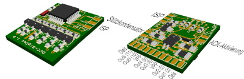

# DCC-Signaldekoder mit ATmega328

## Überblick
Der **DCC-Signaldekoder** dient der Ansteuerung von Signalen mit den erweiterten Zubehör-Protokoll nach nach [NMRA s-9.2.1](https://www.nmra.org/sites/default/files/standards/sandrp/DCC/S/s-9.2.1_dcc_extended_packet_formats.pdf), Abs. 2.4.2.
### Autor
[Michael Hochmuth](https://github.com/Sim-59)

## Hardware
Um das gemeinsame Schalten, insbesondere das synchrone Blinken von Haupt- und Vorsignal zu erreichen, wurde ausgehend von der [4-Port-Variante](https://simandit.de/simwiki/doku.php?id=modellbahn:umbauten:dcc-dekoder#multi-funktions-dekoder_4-port) des DCC-Dekoders mit ATtiny85 eine neue [Leiterplatte](https://simandit.de/simwiki/doku.php?id=modellbahn:umbauten:dcc-dekoder#dcc-signal-dekoder_mit_atmega328) mit einem ATmega328 und sechs PWM-Ausgängen entwickelt, mit der die Anschaltung an das DCC-Gleissignal erfolgt.\
Mit Transistoren für die Funktionsausgänge wird die gleichgerichtete Gleisspannung geschaltet. Die Funktionsausgänge unterstützen Dimmen und Fade-In und FadeOut sowie Blinken. Für LEDs sind Bestückungsplätze für Vorwiderstände vorhanden.\
Zur Erzeugung des ACK-Signals ist ein Anschluss vorgesehen, der vorübergehend zum Lesens der CVs durch einen Schalter oder Jumper überbrückt werden kann. CV-Schreiben ist auch ohne diesen möglich.

## Software
Der Arduino-Sketch verwendet die [NmraDcc-Bibliothek](https://github.com/mrrwa/NmraDcc) von [MRRWA](http://mrrwa.org/), die über die Arduino-Bibliotheksverwaltung eingebunden werden kann.
Es wird das erweiterte DCC-Paket-Format für Zubehör - Extended Accessory Decoder Control Packet Format - verwendet. Damit sind in den meisten Systemen, z.B. DCC-Ex, 32 Signalbegriffe möglich.\
Der Dekoder nutzt eine DCC-Zubehöradresse im Output-Address-Mode. 

Folgende HL-Signal-Begriffe sind mit vier LEDs (statisch und blinkend) für EZMG-Hauptsignale einer DR-Nebenbahn-Strecke möglich:
- Hp0  - Halt (Hl13)
- Hl1  - Fahrt mit Streckenhöchstgeschwindigkeit
- Hl3a - Fahrt mit 40 km/h, dann mit Streckenhöchstgeschwindigkeit
- Hl7  - Geschwindigkeit auf 40 km/h ermäßigen (nur bei Vorsignalfunktion)
- Hl9a - Fahrt mit 40 km/h, Fahrt mit 40 km/h erwarten
- Hl10 - Halt erwarten
- Hl12a - Fahrt mit 40 km/h, Halt erwarten

Bei EZMG-Ausfahrsignalen sind die Signalbilder meist reduziert ausgeführt, nur Hp0 (Hl13), Hl1 bzw. Hl3a bei abzweigender Weiche werden angezeigt, das gelbe obere Licht ist abgedeckt. Dieser Ausgang kann dann bei der Verdrahtung des Signals für 2x Weiß für das Rangiersignal Ra12 genutzt werden. Dieses Signalbild ist als Option bei entsprechender Verdrahtung auch im Sketch umgesetzt.  
- Hp0 + Ra12 - Rangierfahrt erlaubt

Das Vorsignal verwendet zwei LEDs (statisch und blinkend)
Diese Zuordnung der Vor- zu den Hauptsignalbegriffen wurde realisiert:
- HL10 bei Hp0 (HL13)
- HL1 bei HL1, HL10
- HL7 bei HL3a, HL9a, HL12a

Eine Anpassung der Helligkeit der Lichtquellen kann durch Dimmen mit PWM der ATmega-Ports über Konfigurationsvariablen erfolgen.\
Für das langsame Ein-/Ausschalten (Fade-In und Fade-Out) der Lichtquellen sind weitere Konfigurationsvariablen definiert.

## Installation
Die Platine wird in der Arduino-IDE mit einem ISP-Programmer programmiert. Dafür sind an einer Seite Kontaktflächen angeordnet. Als erstes wird ein Bootloader programmiert. Die Vorgehensweise ist auf dieser [Wiki-Seite](https://simandit.de/simwiki/doku.php?id=weiteres:arduino:bootloader#atmega328) beschrieben.
Weitere Informationen sind in der Dokumentation beschrieben.
